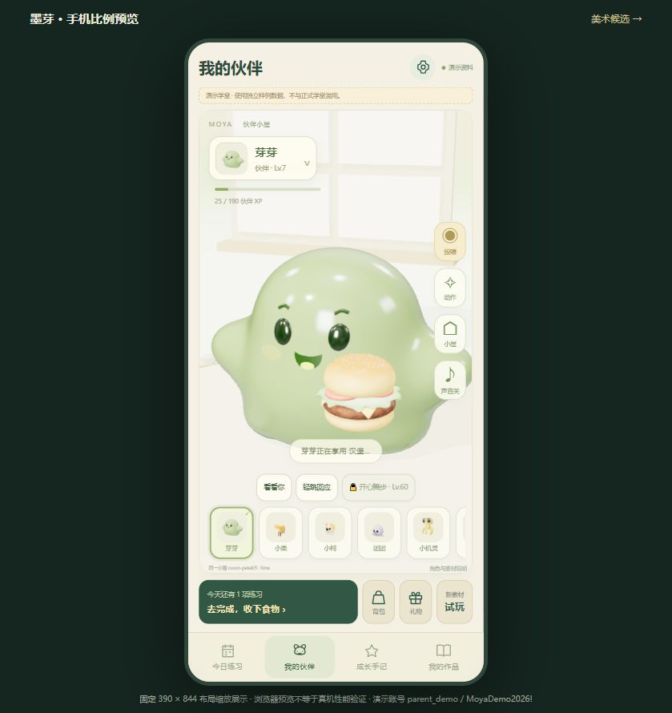
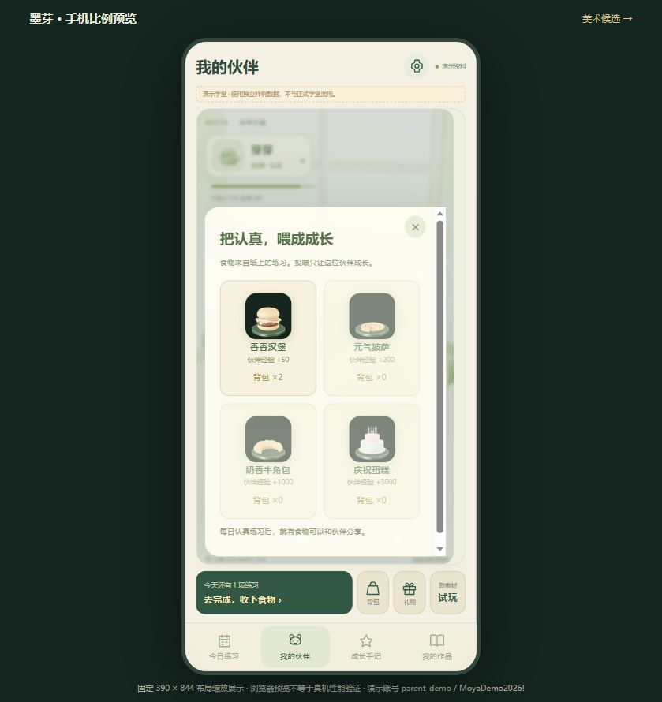
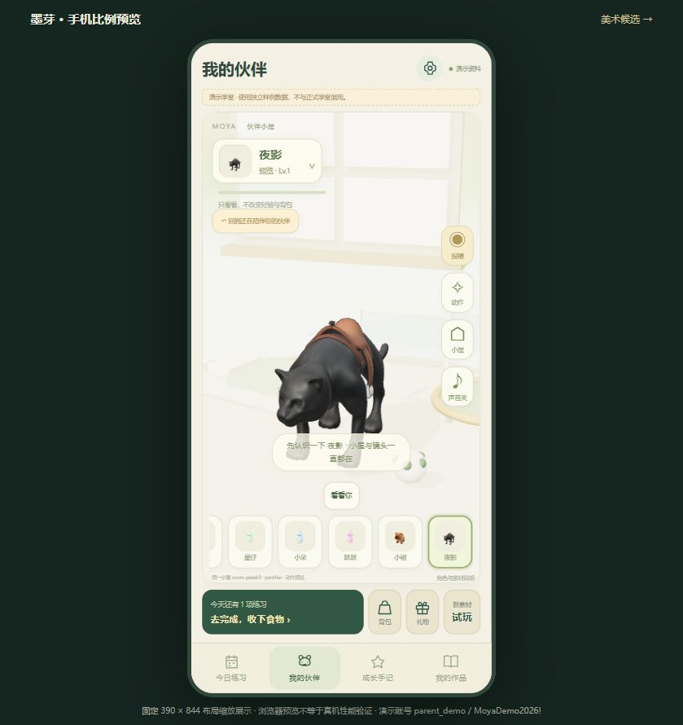

# Learning Platform with Verified Rewards

**MoYa (墨芽)** is an AI-assisted learning product prototype for children's calligraphy practice. It connects a teacher's daily teaching workflow with a student's mobile learning world: submit real practice, receive feedback, earn server-validated rewards, and grow a 3D companion.

[中文说明](README.zh-CN.md) · [Third-party credits](THIRD_PARTY_NOTICES.md) · [License](LICENSE)

> **What “verified rewards” means:** task eligibility, attendance, balances, duplicate claims and unlocks are checked by the backend. Teachers provide the handwriting assessment. This is not an AI handwriting-grading or fraud-proof verification system.

## Product intent

Help children build a sustainable 5–10 minute daily practice habit. Reward effort and personal progress while giving teachers practical tools for assignments, feedback and classroom management. Companion interactions do not generate learning XP. The prototype has no paid reward track or in-app purchases.

The product vision, teaching requirements and aesthetic decisions were directed by the project owner. Implementation, research and iteration were assisted by AI coding agents. The 3D characters, models and sounds are credited third-party works, not claimed as original assets created by this project.

## Screenshots

| 3D feeding interaction | Food and item inventory | Shared companion scene |
| --- | --- | --- |
|  |  |  |

Screenshots show synthetic demonstration data in a 390 × 844 mobile layout. They do not establish native-device performance.

## What works

**Teacher workspace**
- Manage classes, teachers, students and guardian bindings.
- Publish daily practice, additional practice and calligraphy work assignments.
- Review submitted photos with grades, comments and voice feedback.
- Record actual attendance and explicit encouragement gifts.
- Back up and restore local school data with role and ownership checks.

**Student / guardian workspace**
- Submit practice photos, view teacher feedback and browse a practice calendar.
- Recover a missed date by submitting its required work and using a makeup item.
- Earn independent protagonist XP and companion XP; view a curved level reward map and achievement series.
- Feed actual 3D food to a companion, switch characters within one scene, and preview level-gated actions.
- Inspect 3D items, see celebrations, and rename an owned companion using a rename card.
- Use a demonstration-only protagonist level preview without changing real balances or adoption rights.

**Reward integrity**
- Rewards are settled by the backend, not trusted from browser-supplied XP amounts.
- Duplicate daily submissions, attendance records, achievement claims and review rewards are checked.
- Makeup repairs a streak without retroactively paying differences for already settled dates.
- Companion feeding consumes inventory and changes only the selected companion's XP.

## Run locally

Requires **Node.js 24** (the backend uses its built-in SQLite module). No cloud account, paid service or AI API key is required to run the checked-in application.

```sh
git clone https://github.com/hongxinzhen/learning-platform-with-verified-rewards.git
cd learning-platform-with-verified-rewards
npm start
```

Open **http://localhost:4173/**. On a fresh checkout, create an institution administrator, then create classes, students and guardian accounts. There is **no preloaded school database or default production password** in this public repository.

The current compiled viewers and licensed assets are included. Root-level backend dependencies are built into Node.js; rebuilding the viewers is a separate step below.

For a local-network trial on a trusted Wi-Fi network:

```sh
npm run start:lan
```

Use the LAN address printed by the server on the phone. This opt-in mode does not configure router forwarding or firewall rules. A localhost URL on a phone points to the phone itself, not the institution computer.

The `mobile-demo.html` page provides a fixed-size desktop preview of the application. Actual phones should open the application root address. Browser microphone access over LAN HTTP can be restricted; audio-file upload remains available.

## Verify and rebuild

```sh
npm test

npm ci --prefix vendor/jelly-mobile
npm ci --prefix companion-viewer
npm run build:fox
npm run build --prefix item-viewer
```

The latest completed verification run passed **64 automated tests**, covering reward boundaries, role separation, protected media, backup/restore, rename cards, level previews and native companion capabilities. Additional structural verification is available with:

```sh
node design/verify-selected-items.mjs
```

The source bundle linked by local development builds can optionally be regenerated with `python design/build-companion-source.py`. All corresponding source is already tracked here; the generated archive is excluded from Git.

## Architecture

| Part | Implementation |
| --- | --- |
| Learning interface | HTML, CSS and JavaScript; phone-first student views and a teacher workspace |
| Local backend | Node.js HTTP service, SQLite, protected photo/audio storage |
| Reward rules | Shared reward domain with authoritative backend settlement |
| 3D companions | Three.js WebGL, licensed glTF assets, native clips and an adapted Jelly Baby character |
| 3D item / celebration viewer | Local models, Three.js and three.quarks |
| Tests | Node.js built-in test runner |

## Current limits

This is a working local trial and portfolio prototype, not an App Store / APK release or an audited public production service. A host computer must remain running for other devices to access its data. Remote deployment, HTTPS and real-device performance still need deployment-specific validation.

Movement is currently bounded to a small platform; the floating island is not a complete navigable open world. Actions depend on the animations actually present in each source model. Some characters have no native walking clip. Full multi-stage evolution models are not implemented. Feeding choreography is authored at runtime around static licensed food models; it is not an original food-model animation.

## Privacy and repository scope

The repository includes application code, tests, licensed assets, provenance and demonstration screenshots. It excludes school databases, student uploads, local accounts, sessions, backups, dependency folders, generated source archives and internal working notes. Starting the application creates local records under `data/`, which is ignored by Git.

For real classroom use, configure accounts and access for that institution, arrange backups, and validate the target phones and network.

## Licensing and acknowledgments

Application code and the GPL-derived companion integration are distributed under **GPL-3.0-only**. Third-party models, audio and libraries retain their own licenses; they are not relicensed as original MoYa assets.

Important sources include Scott Sun's **Jelly Baby** (GPLv3), Three.js and three.quarks (MIT), Khronos glTF sample assets, Gobkit, Grab3D, individual CC BY model authors, and the sound creators identified in the bundled credits. Full attribution, source URLs, modification notes and hashes are retained in `THIRD_PARTY_NOTICES.md`, viewer credits and per-asset manifests.
